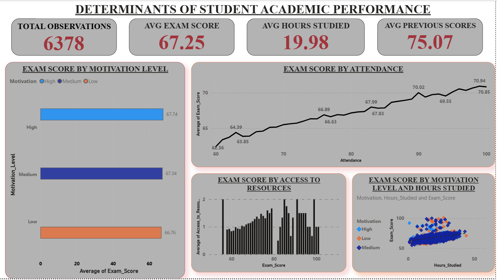

# 🎓 Student Performance Analysis


An end-to-end data analysis project investigating the factors influencing students' academic performance using statistical modelling in Python and interactive data visualization in Power BI.

---

## 📌 Project Facts

**Tools:** Python • Pandas • NumPy • Statsmodels • Power BI • Git • GitHub

**Techniques:** Data Cleaning • Exploratory Data Analysis (EDA) • Multiple Linear Regression • Model Diagnostics • Dashboard Development

**Dataset Size:** **6,378 student records**

---

# 📖 Project Overview

Student academic performance is influenced by a combination of academic, behavioural, and environmental factors. Understanding these relationships can help educators, institutions, parents, and policymakers develop strategies that improve learning outcomes.

This project analyzes **6,378 student records** to identify the major determinants of academic performance using **Ordinary Least Squares (OLS) regression**. Python was used for data cleaning, exploratory data analysis, statistical modelling, and regression diagnostics, while Power BI was used to develop an interactive dashboard that communicates the findings through clear visualizations.

---

# 🎯 Objectives

- Clean and prepare the dataset for analysis.
- Explore relationships between student characteristics and academic performance.
- Identify the most significant factors influencing exam scores.
- Build and evaluate a Multiple Linear Regression model.
- Validate regression assumptions using statistical diagnostic tests.
- Communicate findings through an interactive Power BI dashboard.

---

# 🛠️ Tools & Technologies

- Python
- Pandas
- NumPy
- Statsmodels
- Matplotlib
- Jupyter Notebook
- Power BI
- Git
- GitHub

---

# 📂 Repository Structure

```text
Student-Performance-Analysis
│
├── README.md
├── .gitignore
├── requirements.txt
├── dashboard_overview.png
├── Student_Performance_Analysis.ipynb
├── Student_Data_Cleaned.csv
├── Student_Performance_Dashboard.pbix
└── Student_Performance_Analysis_Report.pdf
```

---

# 📊 Dashboard Preview



---

# 🔬 Methodology

The project followed a structured data analysis workflow.

### 1. Data Preparation

- Data cleaning and preprocessing
- Handling missing and inconsistent values
- Variable formatting and validation

### 2. Exploratory Data Analysis (EDA)

- Descriptive statistics
- Distribution analysis
- Correlation analysis
- Data visualization

### 3. Statistical Modelling

- Ordinary Least Squares (OLS) Regression
- Model evaluation
- Coefficient interpretation

### 4. Model Diagnostics

- Variance Inflation Factor (VIF)
- Breusch–Pagan Test
- Durbin–Watson Test

### 5. Dashboard Development

- Interactive Power BI dashboard
- KPI cards
- Interactive charts
- Dynamic filtering

---

# 📈 Key Findings

The Multiple Linear Regression model achieved an **R² value of 0.721**, indicating that approximately **72.1%** of the variation in student exam scores is explained by the variables included in the model. :contentReference[oaicite:0]{index=0}

The analysis found that:

- 📚 Increased study hours were associated with higher exam scores.
- ✅ Higher attendance significantly improved academic performance.
- 💡 Motivation level positively influenced student achievement.
- 🏆 Previous academic performance was one of the strongest predictors of future exam scores.

The analysis also showed that **Sleep Hours**, **Gender**, and **School Type** were not statistically significant predictors of exam performance within this dataset. :contentReference[oaicite:1]{index=1}

---

# 📊 Model Validation

Several diagnostic tests were conducted to verify the assumptions of the regression model.

| Diagnostic Test | Result |
|-----------------|--------|
| Variance Inflation Factor (VIF) | No evidence of multicollinearity |
| Breusch–Pagan Test | No evidence of heteroskedasticity |
| Durbin–Watson Statistic | No evidence of autocorrelation |

The diagnostic tests confirmed that the assumptions of the OLS regression model were satisfied, indicating that the model is statistically reliable for inference. :contentReference[oaicite:2]{index=2}

---

# 📊 Dashboard Insights

The Power BI dashboard provides an interactive visualization of the key factors affecting student performance.

Key insights include:

- Students with higher motivation consistently achieved better exam scores.
- Increased study hours were associated with improved academic performance.
- Students with higher attendance generally outperformed those with lower attendance.
- Previous academic performance showed strong consistency with future academic achievement.

Interactive visualizations allow users to explore relationships between variables and better understand the factors that contribute to academic success. :contentReference[oaicite:3]{index=3}

---

# 💼 Skills Demonstrated

- Data Cleaning & Preparation
- Data Wrangling
- Exploratory Data Analysis (EDA)
- Statistical Analysis
- Multiple Linear Regression
- Regression Diagnostics
- Data Visualization
- Dashboard Design
- Business Insight Communication
- Git & GitHub Version Control

---

# 📄 Dataset

**Student Performance Factors Dataset**

The dataset contains **6,378 observations** and includes academic, behavioural, environmental, and demographic variables used to analyse factors influencing students' academic performance. :contentReference[oaicite:4]{index=4}

---

# 🚀 Getting Started

Clone this repository:

```bash
git clone https://github.com/tamiah304-ui/Student-Performance-Analysis.git
```

Install the required packages:

```bash
pip install -r requirements.txt
```

Open the Jupyter Notebook to reproduce the analysis and use **Power BI Desktop** to explore the interactive dashboard.

---

# 📬 Contact

**Tamiah Mwangi**

🎓 BSc Economics & Statistics

💼 Aspiring Data Analyst

GitHub: https://github.com/tamiah304-ui

LinkedIn: www.linkedin.com/in/
tamiah-mwangi

